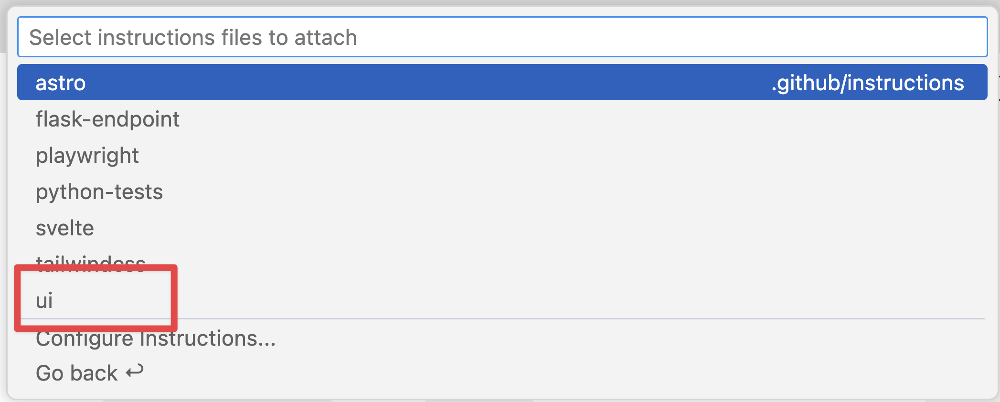

アプリケーションの小さな更新でも、通常は複数のファイルを変更し、テストを実行する必要があります。開発者は関連するファイルを探して変更し、テストを実行して問題を修正します。GitHub Copilot Agent Mode は、IDE 内でより自律的に作業します。プロジェクト構造を調べて必要な変更を行い、テストなどのタスクを実行し、見つかった問題を自動的に修正します。Agent Mode を使ってサイトに機能を追加しましょう。

> [!NOTE]
> 名前は似ていますが、agent mode と cloud agent は異なる用途で設計されています。Agent mode は IDE 内で動作し、すばやいフィードバックとやりとりができます。Cloud agent は、Issue とプルリクエストを通じてチーム メンバーのように非同期で作業します。

この演習では、次の操作を行います。

- Copilot Agent Mode でプロジェクトを調べ、関連するファイルを見つけて、複数のファイルにまたがる変更を行います。
- UI とデータ層にわたって機能を実装します。
- 変更とテストをレビューしてからコードベースにマージします。

## シナリオ

ゲームの一覧が増えてきたため、カテゴリーや発行者で絞り込めるようにします。前の演習では発行者ヘルパーを追加しました。Copilot Agent Mode を使って、残りのデータ層、UI、テストを完成させます。

## Tailspin Toys Web サイトを実行する

変更を加える前に、Tailspin Toys Web サイトの現在の機能を確認します。Tailspin Toys は、開発者をテーマにしたボードゲームのクラウドファンディング サイトです。ゲームの一覧と詳細を表示します。サイトは、ビルド時に静的 HTML を生成する単一の Astro アプリです。ページは frontmatter 内で Drizzle ORM を使ってローカル SQLite データベースを直接参照します。別のバックエンド API やクライアント側 UI フレームワークはありません。再利用可能なデータアクセス ヘルパーは `src/lib/` に置き、インタラクティブな動作には標準 DOM API を使う小さな Astro `<script>` を使います。

### Web サイトを起動する

`npm run dev` タスクを使うと、単一の Astro 開発サーバーを起動できます。

1. Codespace に戻ります。前の演習の後、`main` に戻っているはずです。
2. Codespace で <kbd>Control</kbd>+<kbd>`</kbd> (Mac) または <kbd>Ctrl</kbd>+<kbd>`</kbd> (Windows/Linux) を押して、新しいターミナルを開きます。
3. フィルター作業用のブランチを作成して切り替えます。

   ```bash
   git checkout main
   git pull
   git checkout -b filtering-vscode
   ```

4. 次のコマンドで Web サイトを起動します。

   ```bash
   npm run dev
   ```

   Astro 開発サーバーが起動すると、次のような URL が表示されます。

   ```bash
   🚀 Tailspin Toys is ready!
      Astro server: http://localhost:4321
      Press Ctrl-C to stop.
   ```

> [!NOTE]
> `http://localhost:4321` を開く確認ダイアログが表示された場合は、**x** を選択して閉じます。

5. ターミナルで <kbd>Command</kbd> (Mac) または <kbd>Ctrl</kbd> (Windows/Linux) を押しながら Astro サーバーの `http://localhost:4321` アドレスを選択し、Web サイトを開きます。

> [!NOTE]
> Codespace のターミナルから localhost URL を選択すると、`https://<your-codespace-name>-4321.app.github.dev/` に自動転送されます。これは Codespace 上の Web サーバーに接続するプライベート トンネルです。

### Web サイトを確認する

- **ホーム ページ**: タイトル、画像、説明を含むボードゲームの一覧を表示します。
- **ゲーム詳細ページ**: ゲームを選択すると、タイトル、説明、発行者、カテゴリーなどの詳細が表示されます。

## Copilot でバックログを確認する

> [!TIP]
> **Copilot Chat を開く**
>
> 次の操作に進む前に Codespace に戻り、Copilot Chat パネルを開き、**New Chat** を選択して新しい会話を始めます。

テンプレートからプロジェクトを設定すると、Issue のバックログも自動的に作成されています。GitHub Copilot に項目を表示してもらいましょう。

1. Chat ビューのエージェント ドロップダウンから **Agent** を選択します。

   

2. 使用可能なモデルから **Claude Sonnet 4.5** を選択します。

> [!CAUTION]
> このワークショップの作成者が特定のモデルを推奨するものではありません。ワークショップの作成時に Claude Sonnet 4.5 を使ったため、手順に含めています。LLM は確率的に動作するため、提案は異なる場合があります。これは通常の動作です。

3. 次のプロンプトを Copilot に送ります。

   ```plaintext
   Please show me the backlog of items from my GitHub repository. Help me prioritize them based on those which will be most useful to the user.
   ```

4. Issue 一覧を取得するため **Continue** を選択します。
5. 表示された Issue と優先順位を確認します。

## 命令ファイルを確認する

コード生成を依頼する前に、Copilot にコンテキストを与える命令ファイルを確認します。[ユーザー インターフェイス (UI) 命令ファイル](https://github.com/github-samples/tailspin-toys/blob/main/.github/instructions/ui.instructions.md)には、Web サイトに機能を追加する方法が記載されています。

1. Codespace で `.github/instructions/ui.instructions.md` を開きます。
2. アーキテクチャの概要、コンポーネントの設計・テスト容易性・アクセシビリティの原則、Astro、Tailwind CSS、Drizzle などのファイル種別に関する命令へのリンクを確認します。

> [!TIP]
> 命令ファイルから、他の命令ファイルやプロジェクト内のファイルを参照できます。パスは命令ファイルからの相対パスです。命令を再利用し、大きな命令を小さく分け、例やテンプレートを示すのに便利です。

## フィルター機能を実装する

フィルター機能を完成させるには、データ層 (`src/lib/`) のロジック、フィルター動作のテスト、ゲーム一覧ページの UI を更新し、テストに成功してからマージする必要があります。

1. 現在の Copilot 会話を続けるか、**New Chat** で新しく始めます。
2. **Add Context**、**Instructions**、**ui** の順に選択します。

   

3. エージェント ドロップダウンで **Agent** が選択されていることを確認します。
4. モデルが **Claude Sonnet 4.5** であることを確認します。
5. バックログの関連 Issue に基づいて実装するよう、次のプロンプトを送信します。

   ```plaintext
   Please update the site to include filtering by publisher and category based on the requirements from the related GitHub issue in the backlog. A publishers helper already exists from the previous exercise, so preserve and refine that work as needed while completing the remaining data-layer, UI, and tests. Ensure all tests are passing before completion. The server is already running, so you do not need to start it up.
   ```

6. Copilot が関連するデータ層、UI、テストを調べて変更し、テストを実行する様子を確認します。

   

> [!NOTE]
> Copilot はプロジェクトの調査、ファイルの編集、テストの実行などを行うため、数分かかることがあります。作業中、エディターに **Keep** と **Undo** が表示される場合があります。完了するとすべての変更に対する操作が表示されるため、作業中に選択する必要はありません。

7. Copilot に確認を求められたら **Continue** を選び、テストを実行します。

   

8. 作業中に一時停止したり、テストが失敗したりする場合があります。Copilot はエラーを検出しなくなるまでコード生成とテストを繰り返します。
9. 生成されたコードを確認し、問題がないか調べます。

> [!CAUTION]
> Copilot や他の AI ツールが生成したコードは、必ずレビューしてください。

10. Web サイトを開いているブラウザーに戻り、新しい機能を試します。
11. 動作とコードを確認したら、Copilot Chat で **Keep** を選択します。

## まとめと次のステップ

GitHub Copilot Agent Mode を使い、Tailspin Toys に機能を追加しました。この演習では、次のことを学びました。

- UI とデータ層をまたぐ新しい機能を実装する方法。
- Copilot Agent Mode がプロジェクトを調べ、関連ファイルを見つけ、複数の変更を調整する方法。
- 変更とテストをレビューしてからコードベースにマージする方法。

次は [Playwright MCP サーバーで機能をテストし][next-lesson]、プルリクエストを作成します。

### ボーナス演習 — ページングを実装する

ゲームの一覧が増えた場合に備え、ページングを追加することもできます。この演習で学んだ内容を使い、Copilot にページングを実装するよう依頼します。既存の命令ファイルなどのベスト プラクティスを適用し、ページ サイズをユーザーが選べるようにするか固定にするかを決め、希望する動作を実現するために必要なガイダンスをプロンプトに含めます。意図した結果になるように、Copilot に反復して変更やコンテキストを追加してください。

## リソース

- [Copilot の ask、edit、agent mode: それぞれの役割と使い分け][choose-mode]
- [VS Code の agent mode][vs-code-agent-mode]

[previous-lesson]: ../1-custom-instructions/
[next-lesson]: ../3-mcp/
[choose-mode]: https://github.blog/ai-and-ml/github-copilot/copilot-ask-edit-and-agent-modes-what-they-do-and-when-to-use-them/
[vs-code-agent-mode]: https://code.visualstudio.com/docs/copilot/chat/chat-agent-mode
